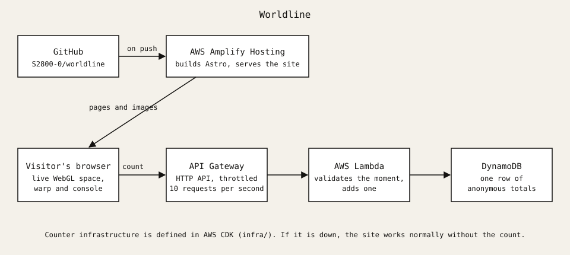

# Worldline

My portfolio. The real site is live deep space. Open the meter, change a decision in my past, and the site becomes the one a different version of me would have made.

Built with [Astro](https://astro.build), hosted on AWS Amplify Hosting, with a small serverless counter defined in AWS CDK.



## Run it

```sh
npm ci
npm run dev
```

After changing page content, regenerate the images the page warp uses:

```sh
npm run shots
```

## How it's made

- **Meter and dial:** 3D renders scripted in Blender (`art/render_meter.py`, `art/render_dial.py`).
- **Paper, books and engravings:** real public-domain scans. See [CREDITS.md](CREDITS.md). The originals aren't committed; `art/textures.sh` lists what they become.
- **Space:** the real Hubble Ultra Deep Field, rendered live (`src/scripts/sky.ts`). Scrolling flies through it, and the pointer bends its light with the point-mass lens equation.
- **Transition:** a small WebGL shader (`src/scripts/warp.ts`) twists an image of the current page away into space, then reveals the new one along the veins of a real marbled book cover.
- **Counter:** API Gateway, Lambda and DynamoDB in `infra/`, throttled, storing only anonymous totals. The site works normally without it.
- **Accessibility:** everything works by keyboard, and reduced motion gets a crossfade. With JavaScript off, the real site still reads in full.

## Deploy the counter

With an AWS login that can create CloudFormation stacks:

```sh
cd infra
npm ci
npm test
npx cdk bootstrap
npx cdk deploy -c siteOrigin=https://YOUR-AMPLIFY-URL
```

Then set `PUBLIC_COUNTER_URL` to the `CounterUrl` output in the Amplify environment variables and redeploy. To remove it: `npx cdk destroy`.
